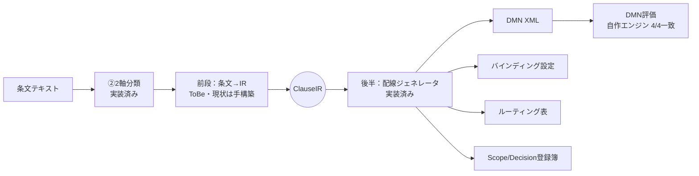

# aoi\_doc2dmn ③a IR→4点セット配線 仕様書

> **この文書について**
> - Claude Docs 上の「aoi_doc2dmn ③a IR→4点セット配線 仕様書」の写し（2026-10-23 時点、改訂番号 30）。正本は Claude Docs：https://claude.ai/code/artifact/11cc2737-119c-4776-8f64-d7085b0afbce 。正本を更新しても、この写しは自動では更新されない。
> - **位置づけ：コミット 9e66776 時点の実装の記録（AsIs）である。** IR の今後の設計は claude/aoi_doc2dmn_IRv2_design.md（IR v2 設計書）を基準とし、食い違う点はそちらを優先する。用語集もそちらを正とする。


Sep 24, 2026 · @kazuhiro MIYASHITA

③a（宣言的×ハード制約）の最初の実装は、条文1件（IPA 6.7 特権アカウント 第3項）で「IR→4点セット→DMN評価」を一気通貫させた段階にある。本書は、実装済みの後半（IR→4点セットの配線）を仕様として固め、未着手の前段（条文→IR）はToBeとして記す。

本書は2026-10-13に、GitHub上のコミット 9e66776（「③a内容生成を実装」）のソースコードと、--use-oracle で再生成した4点セットの実ファイルに照合して改訂した。設計文書（gijinka\_dmn\_generation\_design\_v1 等）と実装が異なる箇所は、実装を正とし、設計との差を明記している。

このプロジェクトに初めて参加する人は、11章の用語集を先に読むとよい。

本書はコミット 9e66776 時点の実装の記録（AsIs）である。ここで見つかった問題への対応（IRの改訂）は、別文書「aoi\_doc2dmn ③a 中間表現（IR）v2 設計書」（Word、2026-10-16）にまとめた。用語集も今後はそちらを正とする。

## 1. 全体像

③aは「前段：条文→IR」と「後半：IR→4点セット」の2工程に分かれ、境界はIR（ClauseIR）である。後半は実装・検証済み、前段は未実装で、現状はClaude Codeが条文を読んでIRを手で組み立てている。



図の通り、4点セットは必ず同一のClauseIRから1回の呼び出しで同時に生成する。別々のタイミングで作ると、Part IIのKogito実機検証で起きた「宣言と実体のズレ」（REQ\_NOT\_FOUND／Unknown variable）が再発するためである。

| 工程 | 状態 | 主なモジュール |
| --- | --- | --- |
| ②2軸分類 | 実装済み（軸1 0.87／軸2 0.96、n=23） | src/stage2\_classify/ |
| 前段：条文→IR | 未実装（手構築） | src/stage3\_generate/golden\_path.py の build\_golden\_path\_ir() と BINDINGS 定数 |
| 後半：IR→4点セット | 実装済み | src/stage3\_generate/ir\_schema.py・wiring\_generator.py |
| DMN評価 | 自作エンジンで検証済み（DMN単体の検証。4.4節）、Kogito実機は未実施 | src/stage3\_generate/dmn\_engine.py |
| 一気通貫実行 | 実装済み | src/stage3\_generate/run\_golden\_path.py（--use-oracle でOllama不要） |

## 2. 前段：条文→IR導出（ToBe）

前段は、②で「ハード制約×宣言的」と分類された条文から、後半が受け取れるClauseIRを自動で組み立てる工程である。現状は未実装で、以下は目標像と着手順序のみを定める。

### 2.1 入出力

- 入力：条文テキスト（clause\_text）、②の分類結果（軸1・軸2のラベル、confidence、evidence\_quote、quote\_verified、vocab\_flagged）、明示的に付与されたcontext（任意）
- 出力：3章で定めるClauseIR

### 2.2 要素分解と着手順序

IR全体を一括で生成させず、要素ごとに小さな判断へ分けて自動化する。②で有効だった「LLMに閉じた判断をさせ、独立ゲートで人間レビューへ落とす」形を踏襲する。

| 順序 | 要素 | LLMの役割 | 人間の役割 | 状態 |
| --- | --- | --- | --- | --- |
| 1 | Action正規化 | 条文の動詞句を既存Action語彙へ対応付け、無ければ新規候補を出す | 新規候補の階層上の位置づけを承認 | 設計済み・ゲート実装済み、LLM部分は未実装 |
| 2 | Scope属性の抽出 | 判定に必要な属性（例：操作者の役割・対象環境・要求権限）を提案 | ゲートが立ったものをレビュー | 未着手 |
| 3 | 決定表の行構成 | 条件と出力の組合せ・行順を提案 | 挿入位置（FIRST）の最終判断 | 未着手 |
| 4 | レベル1/レベル2判定 | 既存決定表との列集合の関係を判定 | 列追加・中間表新設の承認 | 未着手（既存DMNが無く未検証） |

### 2.3 守るべき原則

- IRに入れてよい情報は「clause\_text＋明示的なcontext」に限る（第11回の方針）。レビューアの頭の中の知識を経路なしで混ぜない
- 条文に書かれていない値は、決定表の評価に不要な限りpossible\_valuesに列挙しない（最小主義）
- 条文外の値体系（役割体系など）が本当に必要な場合は、患者マスタと同様にknowledgeSource・context\_providerとして構造的に接続し、出典を残す
- 各要素の自動化は、テストデータでの評価とゲート追加を1周ずつ回してから次へ進む

## 3. 後半①：IR（ClauseIR）の仕様

ClauseIRは1条文分の規範を表す構造で、配線ジェネレータの入力である（src/stage3\_generate/ir\_schema.py）。ただしバインディング設定は IR に含まれず、別引数で渡される（4.1節）。

### 3.1 現状の生成方法（重要）

現状、IRは自動導出されていない。golden\_path.py の build\_golden\_path\_ir() が、Claude Codeが条文を読んで決めた内容（Action、入力列、行の条件と出力、レベル判定の説明文まで）を組み立てる。バインディング設定も同じファイルの BINDINGS 定数として手書きされている。

自動で値が決まるのは、clause\_text・axis1\_result・axis2\_result・review\_gates の4項目と、provenance のうち registered\_at（実行時刻、UTC）だけである。内訳は3.2節の表に示す。

--use-oracle では②を呼ばず、confidence=1.0、evidence\_quote=条文全体、quote\_verified=True を固定で入れる（vocab\_flagged だけは実際に計算）。このモードでは confidence と引用検証のゲートは試されない。

### 3.2 ClauseIR のフィールド

型（フィールドの定義）は14項目すべて実装済みである。未実装なのは「値を自動で決める処理」の方で、自動で決まるのは4項目だけである。残り10項目は、Claude Codeが条文を読んで golden\_path.py に直接書いた値である。下の表の「値の決まり方」列で区別する。

| フィールド | 型 | 内容 | 値の決まり方 |
| --- | --- | --- | --- |
| clause\_ref | str | 条文の参照名 | 手動（定数 CLAUSE\_REF。テストデータのIDからは作らない） |
| clause\_text | str | 条文本文 | **自動**（clauses\_v1.json の text\_raw を読み込む） |
| axis1\_result | AxisResult | 軸1の分類結果 | **自動**（②の分類器。--use-oracle では正解ラベル＋固定値） |
| axis2\_result | AxisResult | 軸2の分類結果 | **自動**（同上） |
| actor | str | 行為主体 | 手動 |
| action | ActionRef | 正規化したAction | 手動（approved\_by だけ引数で渡せる。既定は None） |
| scope | str | 自由記述のラベル。配線では使われない | 手動 |
| level\_determination | LevelDetermination | レベル1／2判定（3.6節） | 手動（説明文まで） |
| rule\_row\_additions | list\[RuleRowDraft\] | 既存決定表へ追加する行（レベル2用） | 手動（今回は空） |
| new\_decision\_tables | list\[NewDecisionTableDraft\] | 新規決定表（レベル1用） | 手動（入力列・行の条件と出力・IDまで） |
| compound\_fact\_application | CompoundFactApplication | 複合factをどこで表したか | 手動 |
| provenance | Provenance | 来歴 | ほぼ手動（registered\_at だけ実行時刻を自動で入れる） |
| review\_gates | ReviewGates | 人間レビューのゲート | **自動**（build\_review\_gates() が計算） |
| human\_review\_status | "pending" / "approved" / "rejected" | レビュー状態 | 手動（ゲートからは決めず pending を固定で入れる） |

自動の4項目にも注意点が2つある。

- review\_gates の new\_action\_unapproved は、手で決めた action.is\_new から計算される。計算は自動でも、元になる値は手動である
- --use-oracle では axis1\_result・axis2\_result の confidence・quote\_verified が固定値になるため、自動で計算されるのはラベル以外では vocab\_flagged だけである

手動の10項目を自動化するのが、前段（2章）の作業である。Action正規化が action、Scope属性の抽出が new\_decision\_tables の入力列、行構成がその行、レベル判定が level\_determination にそれぞれ対応する。ただし human\_review\_status は自動化の対象ではなく、人間がレビューして approved／rejected に変えるための項目である。その結果を記録してIRに反映する仕組みはまだない。

all\_fact\_keys() は、rule\_row\_additions の条件キーと、各新規決定表の input\_columns・行の条件キーを合わせた集合を返す。クロス検証（4.3節）はこの集合を使う。

### 3.3 部品の型

ClauseIR の各フィールドを構成する型を、フィールド単位で説明する。「今回の値」はゴールデンパス（特権アカウント条文）での値である。ReviewGates は3.4節で扱う。

| 型 | フィールド | 意味 | 今回の値 |
| --- | --- | --- | --- |
| AxisResult | label | 分類結果のラベル。軸1はハード制約／判断ガイド／エスカレーション基準、軸2は宣言的／手続き的 | ハード制約（軸1）、宣言的（軸2） |
| AxisResult | confidence | LLMが自己申告する確信度（0〜1）。実測では常に0.7を超え、正誤の目安にならない | 1.0（--use-oracle） |
| AxisResult | rationale | LLMが書いた判定理由の文章 | — |
| AxisResult | evidence\_quote | 判定の根拠として条文から一字一句引用した文字列 | 条文全体（--use-oracle） |
| AxisResult | quote\_verified | evidence\_quote が条文中に実在するかをプログラムで確かめた結果。False ならハルシネーションの疑い | True |
| AxisResult | vocab\_flagged | 誤分類しやすい既知の語彙（認められ／申し出／許可を得／承認を受け・得）を含むか。ルールベースで判定 | False |
| AxisResult | strategy\_id | どの分類器（プロンプト）で判定したか。任意で、現状は使われていない | None |
| AxisResult | confidence\_below\_threshold（プロパティ） | confidence < 0.7 なら True。レビューのゲートに使う | False |
| ActionRef | surface | 条文中の行為の表現そのまま | 特権/管理者権限で操作を行う |
| ActionRef | normalized | 正規化したAction名。ルーティング表で文字列一致に使う | 特権操作 |
| ActionRef | parent | Actionの階層上の親 | システム操作 |
| ActionRef | is\_new | 既存のAction語彙にない新しい語か | True |
| ActionRef | approved\_by | 新しい語の階層上の位置づけを承認した人。未承認なら None | None |
| LevelDetermination | atomic\_fact\_layer | 事実の層の判定（既存の一致プリミティブで賭えるか）。3.6節 | proper\_subset |
| LevelDetermination | intermediate\_layer | 中間判定の層の判定（既存の中間判定の出力値で表せるか） | exact\_match |
| LevelDetermination | final\_layer | 最終判定の層の判定（既存の表に行を足すか、新しい表か） | intersecting\_non\_subset |
| LevelDetermination | outcome | 結論。level1\_new\_table（新しい決定表）か level2\_row\_addition（既存の表に行を追加） | level1\_new\_table |
| LevelDetermination | reused\_intermediate\_decisions | 再利用する既存の中間判定のID | 空 |
| ColumnSetRelation | layer | どの層の判定か（atomic\_fact／intermediate／final） | — |
| ColumnSetRelation | relation | 列集合の関係（exact\_match／proper\_subset／intersecting\_non\_subset）。3.6節 | — |
| ColumnSetRelation | detail | 判定理由の説明文 | — |
| NewDecisionTableDraft | decision\_table\_id | DMNの decisionTable 要素のID | dt\_privileged\_operation |
| NewDecisionTableDraft | decision\_id | DMNの decision 要素のID | decision\_privileged\_operation |
| NewDecisionTableDraft | decision\_name | 判定の名前（DMNの decision 名） | 特権操作可否判定 |
| NewDecisionTableDraft | depends\_on\_decisions | この判定が使う他の判定（中間判定）のID | 空 |
| NewDecisionTableDraft | depends\_on\_inputs | この判定が使う入力事実 | input\_columns と同じ |
| NewDecisionTableDraft | input\_columns | 決定表の入力列。「判定名.出力名」の形は他の判定の出力を指す | operator\_role, target\_environment, requested\_privilege |
| NewDecisionTableDraft | rule\_rows | 決定表の行（RuleRowDraft）の一覧 | 2行 |
| NewDecisionTableDraft | knowledge\_sources | 来歴として紐付ける知識源。計算には使わない | ks\_privileged\_account\_registry, ks\_action\_request |
| RuleRowDraft | row\_id | 行ID。DMNの rule id と登録簿の row\_id になる | id\_r\_priv\_1, id\_r\_priv\_2 |
| RuleRowDraft | decision\_table\_id | 所属する決定表 | dt\_privileged\_operation |
| RuleRowDraft | position | FIRSTでの評価順（1始まり）。小さいほど先に評価される | 1, 2 |
| RuleRowDraft | conditions | 列名 → 条件値。"-" は何でもよい（ワイルドカード） | 1行目：システム開発担当／本番環境／特権 |
| RuleRowDraft | outputs | 出力名 → 値 | 1行目：decision=禁止、reason\_code=dev\_privileged\_op\_on\_production |
| CompoundFactApplication | option\_taken | 複数条件の組み合わせ（AND）をどこで表すか。existing\_table\_row\_addition（決定表の行）／new\_intermediate\_table（中間の表を挟む）／rejected\_compound\_in\_primitive（一致モジュールでANDを組む。禁止で、配線ジェネレータが停止する） | existing\_table\_row\_addition |
| CompoundFactApplication | rationale | その表し方を選んだ理由 | — |
| Provenance | origin | 由来の種類。規程の条文なら regulation\_clause | regulation\_clause |
| Provenance | clause\_ref | 根拠となる条文 | IPA情報セキュリティ関連規程 6.7 特権アカウント(第3項) |
| Provenance | registered\_by | 登録した人・仕組み | claude\_code |
| Provenance | registered\_at | 登録日時（ISO8601、UTC）。生成した時刻が入る | 実行時刻 |

ColumnSetRelation の exact\_match（列集合が完全一致）は、バインディング設定の primitive 名 exact\_match とは別物である。同名なので読むときに注意。

### 3.4 ReviewGates

4つのゲートを独立した真偽値のまま持ち、should\_review はそのORである。build\_review\_gates(axis1, axis2, action) が組み立て、軸1・軸2のどちらかが該当すれば立つ。

| ゲート | 立つ条件 | reasons() の文言 |
| --- | --- | --- |
| confidence\_below\_threshold | confidence < 0.7 | confidence < 0.7 |
| quote\_unverified | quote\_verified=False | evidence\_quoteが条文中に実在しない(ハルシネーション疑い) |
| vocab\_flagged | vocab\_flagged=True | 既知の語彙的盲点パターンを含む |
| new\_action\_unapproved | is\_new=True かつ approved\_by=None | 新規Actionが未承認 |

reasons() が返すのはゲート名ではなく、上の日本語の説明文である。今回は new\_action\_unapproved だけが立ち、should\_review=True となった。

### 3.5 今回のIR

対象条文：ipa\_secguide\_v4\_6\_7\_1「システム開発を担当する者が本番環境において特権/管理者権限で操作を行うことを禁止する。」

| 項目 | 値 |
| --- | --- |
| clause\_ref | IPA情報セキュリティ関連規程 6.7 特権アカウント(第3項) |
| actor / scope | あおい / 情報システムの運用操作 |
| action | surface=特権/管理者権限で操作を行う、normalized=特権操作、parent=システム操作、is\_new=True、approved\_by=None |
| 新規決定表 | dt\_privileged\_operation（decision\_privileged\_operation「特権操作可否判定」）、入力列 operator\_role・target\_environment・requested\_privilege、2行 |
| knowledge\_sources | ks\_privileged\_account\_registry、ks\_action\_request |
| level\_determination | atomic\_fact=proper\_subset、intermediate=exact\_match、final=intersecting\_non\_subset → level1\_new\_table |
| compound\_fact\_application | existing\_table\_row\_addition（ANDは決定表の1行で表現） |
| provenance | regulation\_clause、registered\_by=claude\_code |
| human\_review\_status | pending（new\_action\_unapproved） |

final\_layer の判定は、既存DMNが存在しないため形式的なものであると detail に記されている。

### 3.6 レベル1／2判定（3層×3パターン）

レベル1／2判定は、新しい条文を既存の決定表に行として足すか（レベル2）、新しい決定表を作るか（レベル1）を決める手順である。判断の材料は「その条文がどの事実（列）を必要とするか」で、決定表の依存構造（DRD）の層ごとに別々に判定する。IRでは level\_determination に入る。

#### (1) 何を解決するためのものか

抽出パイプラインを条文ごとに回すと、そのたびに決定表の候補ができる。毎回新しい表を作ると、表が乱立して矛盾検知も難しくなる。逆に何でも既存の表に詰め込むと、無関係な列だらけの巨大な表になる。そこで、条文ごとにどちらにするかを決める。

| レベル | 意味 | 対応 |
| --- | --- | --- |
| レベル1 | 業務領域や判定の性質が違う | 新しい決定表（必要なら別のDMNファイル）を作る |
| レベル2 | 既存の決定表と同じ判定に属する | 既存の表に行を追加する。FIRSTなので挿入位置の判断が必要 |

当初は「Actionの上位概念が同じなら同じ表」で判定できると考えていた。しかし第14条（電話での口頭伝達の制限）で試すと、「口頭伝達」も「外部送信」も親は「情報開示」で同じなのに、判定に必要な事実はまったく違った。そこで基準を「判定に必要な事実（列）の集合が、既存の表とどういう関係にあるか」に改めた。

#### (2) 「列の集合の関係」とは

決定表の「列」は、その判定が見る事実の項目である。新しい条文が判定のためにどの項目を見る必要があるかを書き出し、既存の決定表が見ている項目と並べて比べる。

たとえば、あおいの送信可否判定（dt\_transmission）は次の3項目を見て「許可／禁止」を決めている。この表が見る事実の集合は {機微度, 確認レベル, 連絡同意} である。

| 機微度 | 確認レベル | 連絡同意 | → 判定 |
| --- | --- | --- | --- |
| - | - | 不同意 | 禁止 |
| 最高 | 高 | 同意 | 条件付き許可 |
| 高 | 高・中 | 同意 | 許可 |

新しい条文が来たら、「この条文の白黒を付けるには何が分かればよいか」を書き出す。第14条なら必要なのは「本人確認がどのレベルで取れたか」だけで、集合は {確認レベル} である。既存の表の集合と比べると、関係は次の3通りに分かれる。

| 関係 | 意味 | 例（架空の条文） | 扱い |
| --- | --- | --- | --- |
| 完全一致（exact\_match） | 新しい条文の列集合が、既存の表の列集合と同じ | 「機微度が最高の情報は、確認レベルが高で、かつ連絡同意がある場合のみ送ってよい」→ {機微度, 確認レベル, 連絡同意} | そのまま行を追加する |
| 真部分集合（proper\_subset） | 既存の列の一部だけを使う | 「連絡同意がなければ、どんな情報も送ってはならない」→ {連絡同意}。既存の表の1行目がこの形 | 使わない列を「-」にして行を追加できる。FIRSTでの挿入位置を検討する |
| 交差するが部分集合ではない（intersecting\_non\_subset） | 既存の列の一部に加え、既存の表にない列も必要 | 「深夜帯は、機微度が高以上の情報を送ってはならない」→ {機微度, 時間帯}。時間帯は既存の表にない | 列を追加するか、新しい表を作る。列を足す場合、既存の全行に「時間帯は何でもよい」を埋め、正しく埋まっているかの監査が必須 |

行を足せるかどうかは、結局「既存の表の列だけで、その条文の条件を書けるか」で決まる。書けるなら（完全一致・真部分集合）行の追加で済む。書けない列があるなら（交差）、列を足すか新しい表を作るしかない。「Actionの親が同じ」ではうまくいかなかったのは、表に入れるかを決めるのが名前の近さではなく、見ている事実の重なりだからである。

ただし、列の関係が教えてくれるのは「行を足すことが技術的に可能か」だけである。「足すべきか（同じ業務の判定か）」は別に考える必要があり、そのために次の3層に分ける。

#### (3) 3層：DRDの層ごとに別々に判定する

あおいの送信可否判定は、事実 → 中間判定（本人確認判定など）→ 最終判定（送信可否判定）という層構造になっている。新しい条文がどの層まで既存の部品を使えるかは層ごとに違うため、層ごとに別の問いを立てる。

| 層（IRのフィールド） | 問うこと | 結果の種類 |
| --- | --- | --- |
| ① 事実の層（atomic\_fact\_layer） | 必要な比較を、既存の一致プリミティブで賭えるか | 賭える／新しいプリミティブが必要 |
| ② 中間判定の層（intermediate\_layer） | 必要な判定の意味（例：「確認レベル」）を、既存の出力値で表せるか | 既存値で代替できる／行の追加が必要／列の追加が必要 |
| ③ 最終判定の層（final\_layer） | 最終的な判定を、既存の中間判定の出力の組み合わせだけで表せるか | 行の追加（レベル2）／新しい決定表（レベル1。中間判定は再利用可） |

この分け方により、「最終判定は新しい表にするが、中間判定は既存のものを再利用する」という結論を出せる。

#### (4) 実例：第14条

第14条は「生年月日と連絡先の一致が確認できない場合、医療情報を口頭で伝えてはならない」という条文である。

- **② 中間判定の層（本人確認判定）**：条文は「氏名を問わず、生年月日＋連絡先」の一致を求める。既存の確認レベル4値はどれも氏名の一致が前提なので、該当する値がない。真部分集合パターンとして行を1つ追加し、新しい出力値「中（氏名なし・2要素一致）」を足した
- **③ 最終判定の層**：判定に使うのは確認レベルだけで、送信可否判定の残り2列（機微度・連絡同意）とは交わらない。そこで最終判定は新しい表（dt\_verbal\_disclosure）とし、本人確認判定は再利用した

第14条は {確認レベル} で既存の表の真部分集合だが、最終判定は新しい表にした。外部送信の表に足すと、「確認レベルが足りなければ禁止」という行が外部送信の判定にも効いてしまうからである。新しい出力値を既存の「中（2要素一致）」に揃えなかったのも、揃えると第14条のための変更が外部送信の判定に黙って波及するからである。

#### (5) 実装の現状と問題点

コードでは LevelDetermination として、3層それぞれの ColumnSetRelation と結論（outcome）を持つ。ただし判定するロジックはまだなく、今回の値もClaude Codeが手で書いている。

また、設計では層ごとに「結果の種類」が違うのに、実装は3層すべてに同じ列集合の3パターンを当てはめている。その結果、今回のIRは次のように読みにくい値になっている。

| 層 | 入っている値 | 本当に言いたいこと |
| --- | --- | --- |
| ① 事実の層 | proper\_subset | 既存のプリミティブで賭える |
| ② 中間判定の層 | exact\_match | 中間判定は不要 |
| ③ 最終判定の層 | intersecting\_non\_subset | 新しいActionなので新しい表（結論は level1\_new\_table） |

それぞれの意味は、自由記述の detail を読んで初めて分かる。既存の決定表がない今回は実害はない。しかしレベル2の条文で判定ロジックを実装するときは、層ごとの結果を別々の型にしないと、機械的に判定・検証できない。

## 4. 後半②：配線ジェネレータの仕様

配線ジェネレータ（src/stage3\_generate/wiring\_generator.py）は、ClauseIRとバインディング設定を受け取り、4点セットを1回の呼び出しで返す。「配線」とは、同じ変数名・キーが4つの成果物の間で一致してつながっている状態を指す。

### 4.1 インターフェース

```python
generate_wiring_bundle(
    ir: ClauseIR, *,
    existing_binding_fact_keys: set[str],   # 既に登録済みのfactキー
    new_bindings: list[dict] | None,        # このIRが要求する新規バインディング
    definitions_id: str, definitions_name: str, namespace: str,
) -> WiringBundle  # dmn_xml, bindings, routing_table, registry
```

WiringBundle.write\_all(out\_dir, basename) が `<basename>.dmn`・`<basename>_bindings.json`・`<basename>_routing.json`・`<basename>_registry.json` の4ファイルを書き出す。ゴールデンパスの basename は privileged\_operation。

**「同一IRから同時生成」は3点にしか当てはまらない。** DMN XML・ルーティング表・登録簿はIRから生成されるが、バインディング設定は呼び出し側が渡した new\_bindings をそのまま出力する。IRとのつながりは、キー集合のクロス検証（4.3節）だけである。

### 4.2 処理の流れ

1. \_enforce\_no\_compound\_in\_primitive()：IRの compound\_fact\_application.option\_taken が rejected\_compound\_in\_primitive なら停止
2. クロス検証（不足・余剰）
3. 登録簿を組む（層1・層2・review、8章）
4. render\_dmn\_xml() でDMN XMLを作る（5章）
5. \_derive\_route() でルーティング表を作る（7章）
6. new\_bindings をそのまま bindings として詰め、WiringBundle を返す

### 4.3 クロス検証

| 検証 | 内容 | 状態 |
| --- | --- | --- |
| 不足 | IRのフラットなfactキー（「決定名.出力名」のドット参照を除く）が、すべて existing\_binding\_fact\_keys か new\_bindings にある | 実装済み |
| 余剰 | new\_bindings の variable が、すべてIRのフラットなfactキーに含まれる。既存バインディングは対象外 | 実装済み（referenceからの追加） |
| 複合fact拒否 | IRの option\_taken を見る。バインディングの primitive の中身は検査しない | 実装済み |
| sources と primitive 引数の一致 | sources のキーが primitive の引数名と一致するか | 未実装 |
| possible\_values と決定表の突合 | 決定表が参照する値が possible\_values にあるか（なければその行は絶対にヒットしない） | 未実装 |

本書の改訂時にこちらで再実行した結果：不足（バインディング3件中2件）・余剰（未参照の extra）・複合factは、いずれも SchemaWiringError になった。一方、possible\_values から「システム開発担当」を抜いた場合と、sources を意味のないキーにした場合は、検出されずに通った。なお、この3種の失敗テストはリポジトリにコミットされていない。

### 4.4 検証結果

2026-10-13 に --use-oracle で再実行し、シナリオ4件すべて期待通りだった。ただし、シナリオは「システム開発担当」などの値をDMNエンジンへ直接渡している。バインディング設定も一致プリミティブも通らないため、**4/4が示すのはDMNの判定ロジックが正しいことだけで、配線が実行時に機能することはまだ確かめていない**。自作エンジンは reference/ の dmn\_engine.py をロジック変更なしで移植したもので、Kogito実機での評価は未実施。

| シナリオ | 入力（role / env / privilege） | 期待 | ヒット行 |
| --- | --- | --- | --- |
| 開発担当者が本番で特権操作 | システム開発担当 / 本番環境 / 特権 | 禁止 | id\_r\_priv\_1 |
| 開発担当者だが検証環境 | システム開発担当 / 検証環境 / 特権 | 許可 | id\_r\_priv\_2 |
| 開発担当者が本番だが一般権限 | システム開発担当 / 本番環境 / 一般 | 許可 | id\_r\_priv\_2 |
| 運用担当者が本番で特権操作 | 運用担当 / 本番環境 / 特権 | 許可 | id\_r\_priv\_2 |

## 5. DMN XMLの仕様（今回関連する範囲）

DMN XMLは規則ロジックそのものを持つ成果物である。render\_dmn\_xml() が、IRの new\_decision\_tables から完結したDMNファイルを1本作る。名前空間は DMN 1.5（https://www.omg.org/spec/DMN/20240513/MODEL/）である。既存DMNへの行追加（レベル2、rule\_row\_additions）はDMNには書き出されず、登録簿にだけ載る。

### 5.1 要素と生成規則

| DMN要素 | 役割 | 生成規則 |
| --- | --- | --- |
| definitions | ファイル全体 | id・name・namespace は呼び出し側が指定（privileged\_operation\_definitions / 特権操作可否判定 / http://gijinka.example.com/dmn/privileged\_operation） |
| decision | 判定そのもの | id=decision\_id、name=decision\_name。子に variable（typeRef=Any） |
| informationRequirement | 計算依存 | input\_columns 1列につき1つ。列名に「.」があれば requiredDecision、なければ requiredInput href="#id\_<列名>" |
| authorityRequirement | 来歴の紐付け | knowledge\_sources 1件につき1つ。decision に付ける |
| decisionTable | 決定表 | id=decision\_table\_id、hitPolicy=FIRST（固定） |
| input | 入力列 | id=in\_<列名>、inputExpression は typeRef=string・text=<列名> |
| output | 出力列 | 全行の outputs のキーを登場順に集める。id=out\_<名前>、typeRef=string |
| rule | 1行 | id=row\_id、position の昇順に並べる |
| inputData | 事実 | id=id\_<列名>、name=<列名>、variable typeRef=string |
| knowledgeSource | 来歴専用 | id=name=\<knowledge\_source名>。計算には使わない |

要素のidのうち informationRequirement・authorityRequirement・inputExpression・inputEntry・outputEntry は毎回乱数で付く（例：\_ir\_FD7ADAEFE1E5）。同じIRから生成しても文字列としては毎回変わる。

### 5.2 守るべき制約

- **inputData名＝FEEL式の変数名＝バインディング設定の variable**。ずれるとKogitoでSKIPPED（REQ\_NOT\_FOUND）になる。生成器は input\_columns から三者を作るので、DMN内では構造的にずれない
- **authorityRequirementは inputData に付けられない**（DMNスキーマ上、decision と knowledgeSource のみ）。来歴は decision 単位で表す
- **マスタ類は inputData にしない**。計算に使わないものを inputData にすると SKIPPED になる（Part IIの1回目の失敗）。knowledgeSource にする
- **決定間依存は「決定名.出力名」**。生成器は対応済みだが、今回は未使用

### 5.3 決定表（dt\_privileged\_operation）

| position（rule id） | operator\_role | target\_environment | requested\_privilege | decision | reason\_code |
| --- | --- | --- | --- | --- | --- |
| 1（id\_r\_priv\_1） | "システム開発担当" | "本番環境" | "特権" | "禁止" | "dev\_privileged\_op\_on\_production" |
| 2（id\_r\_priv\_2） | - | - | - | "許可" | "not\_prohibited\_combination" |

危険な条件（禁止）を上位行に、ワイルドカードの既定行を最後に置く。「開発担当 かつ 本番 かつ 特権」のANDは1行の3列で表す（複合fact禁止原則）。FIRSTでは挿入位置が意味を左右するため、行の追加は末尾追加と考えてはならない。

### 5.4 セルの書き方（\_feel\_literal）

| 入力 | 出力されるFEEL |
| --- | --- |
| - | -（ワイルドカード） |
| 引用符で始まる値（"中", "未" など） | そのまま（候補リストとして扱う） |
| それ以外 | 二重引用符で囲んだ文字列リテラル |

出力セルにも同じ規則が適用される。数値・範囲・否定などのFEELは未対応。

### 5.5 生成物の抜粋

```xml
<definitions xmlns="https://www.omg.org/spec/DMN/20240513/MODEL/"
             id="privileged_operation_definitions" name="特権操作可否判定"
             namespace="http://gijinka.example.com/dmn/privileged_operation">
  <decision id="decision_privileged_operation" name="特権操作可否判定">
    <variable id="var_decision_privileged_operation" name="特権操作可否判定" typeRef="Any" />
    <informationRequirement id="_ir_..."><requiredInput href="#id_operator_role" /></informationRequirement>
    <!-- target_environment / requested_privilege も同様 -->
    <authorityRequirement id="_auth_..."><requiredAuthority href="#ks_privileged_account_registry" /></authorityRequirement>
    <authorityRequirement id="_auth_..."><requiredAuthority href="#ks_action_request" /></authorityRequirement>
    <decisionTable id="dt_privileged_operation" hitPolicy="FIRST">
      <input id="in_operator_role" label="operator_role">
        <inputExpression id="_ie_..." typeRef="string"><text>operator_role</text></inputExpression>
      </input>
      <!-- 他2列 -->
      <output id="out_decision" label="decision" name="decision" typeRef="string" />
      <output id="out_reason_code" label="reason_code" name="reason_code" typeRef="string" />
      <rule id="id_r_priv_1">
        <inputEntry id="_in_..."><text>"システム開発担当"</text></inputEntry>
        <!-- "本番環境" / "特権" -->
        <outputEntry id="_out_..."><text>"禁止"</text></outputEntry>
        <outputEntry id="_out_..."><text>"dev_privileged_op_on_production"</text></outputEntry>
      </rule>
      <rule id="id_r_priv_2"> <!-- 入力はすべて - 、出力は "許可" / "not_prohibited_combination" --> </rule>
    </decisionTable>
  </decision>
  <inputData id="id_operator_role" name="operator_role">
    <variable id="var_id_operator_role" name="operator_role" typeRef="string" />
  </inputData>
  <!-- target_environment / requested_privilege も同様 -->
  <knowledgeSource id="ks_privileged_account_registry" name="ks_privileged_account_registry" />
  <knowledgeSource id="ks_action_request" name="ks_action_request" />
</definitions>
```

図の配置情報（DMNDI）は生成しない。名前空間の登録だけはコードにあるが、使われていない。

## 6. バインディング設定

バインディング設定は、DMNの各inputDataの値を実行時に「どのデータ源のどの値に、どの一致プリミティブを適用して作るか」を宣言するJSONである。ただし現状は宣言だけで、読んで実行する部品はリポジトリにない（6.4節）。

### 6.1 目的と役割（設計の意図）

- **DMNと生データの分離**：DMNには判定に必要な値だけを渡し、患者氏名などの生値はDMNの外（一致モジュール）に留める（データ最小化）
- **規範と技術の分離**：条文由来で変わるのは配線（この設定）だけで、比較アルゴリズムは固定ライブラリにする
- **オーケストレータの汎用化**：業務ロジックをコードに直書きせず、設定を読むだけのインタプリタにできる

### 6.2 実装の形

factの JSON 配列である。各要素のフィールドは次の通り。

| フィールド | 内容 |
| --- | --- |
| variable | DMNのinputData名。IRのフラットなfactキーと突合されるのはこのフィールドだけ |
| primitive | 一致プリミティブ名。今回は3件とも exact\_match |
| possible\_values | そのfactが取りうる値の一覧 |
| sources | 引数名 → 「<データ源>.<パス>」の文字列 |

```json
[
  { "variable": "operator_role", "primitive": "exact_match",
    "possible_values": ["システム開発担当", "運用担当", "その他"],
    "sources": { "subject": "action_request.operator.role",
                 "registry": "privileged_account_registry.role" } },
  { "variable": "target_environment", "primitive": "exact_match",
    "possible_values": ["本番環境", "検証環境", "開発環境"],
    "sources": { "subject": "action_request.target.environment" } },
  { "variable": "requested_privilege", "primitive": "exact_match",
    "possible_values": ["特権", "一般"],
    "sources": { "subject": "action_request.requested_privilege",
                 "registry": "privileged_account_registry.granted_privilege" } }
]
```

上は golden\_path.py の BINDINGS 定数をそのまま出力したものである。

### 6.3 設計文書との差

| 項目 | 設計文書（gijinka\_dmn\_generation\_design\_v1） | 実装 |
| --- | --- | --- |
| トップレベル | dmn\_file・context\_providers・facts を持つオブジェクト | factの配列だけ |
| sources の値 | {from, path} または {from: literal, value} | 「<データ源>.<パス>」の文字列 |
| exact\_match の引数 | claimed と registered の2つ | subject と registry。target\_environment は subject だけ |
| exact\_match の possible\_values | 一致 / 不一致 / 未提供 | 役割名・環境名などの生の値 |
| comparison\_kind | 任意で記載 | 使われていない |

特に下の2行は、exact\_match という名前と実際の使われ方が合っていない。決定表は生の役割名を条件にしているので、実態は「値をそのまま渡す passthrough」に近い（9章の1）。

### 6.4 実行時の扱い

リポジトリには、一致プリミティブの実装（FACT\_RESOLVERS）も、バインディング設定を読むオーケストレータもない。したがって primitive・sources・possible\_values は、今のところどこからも使われていない。使われているのは variable だけで、クロス検証のキー突合に使われる。

参考として、設計文書が定める一致プリミティブのカタログを残す（いずれも未実装）。

| primitive | sources | possible\_values | 内容 |
| --- | --- | --- | --- |
| exact\_match | claimed, registered | 一致 / 不一致 / 未提供 | 正規化なしの完全一致 |
| fuzzy\_match\_name | claimed, registered | 一致 / 不一致 / 未提供 | NFKC正規化・空白除去・小文字化の後に完全一致 |
| date\_match | claimed, registered | 一致 / 不一致 / 未提供 | 日付を正規形にして比較 |
| passthrough | value | fact固有 | 比較せず値をそのまま採用 |
| ontology\_class\_match | subject, target\_class | 含む / 含まない | IS-A階層での包含判定 |
| identifiability\_classifier | data\_category, care\_setting | 可能 / 不可能\_院内 / 不可能\_公開 | 複数入力の分類（境界事例） |

### 6.5 整合ルール

| ルール | 状態 |
| --- | --- |
| variable の集合 ＝ IRが要求するfactキーの集合（過不足なし） | 検証あり |
| sources のキー ＝ primitive の引数名 | 検証なし |
| 決定表が参照する値 ⊆ possible\_values | 検証なし |
| primitive は単一比較または素通しのみ | IRのフラグでのみ検証 |
| 条文にない値は、評価に不要な限り possible\_values に入れない | 未採用。今回も運用担当・検証環境・開発環境・一般など条文外の値が入っている |

## 7. ルーティング表

ルーティング表は、行動要求の「Actor×Action」から評価すべき判定を引くための対応表である。ただし現実装の表には「どの判定を呼ぶか」が書かれていない（7.2節）。

### 7.1 目的と役割（設計の意図）

- **判定の特定**：行動要求（actor=あおい、action=特権操作）が来たとき、どのDMN決定を呼ぶかを決める
- **必要な事実の洗い出し**：入力列から、バインディング設定のどのfactを解決すべきかが決まる
- **実行時の静的化**：実行時は文字列の完全一致で引くだけ。Action名の表記ゆれは、設計時の2段階ルックアップ（LLMが候補、人間が承認）で吸収済みである前提

### 7.2 実装の形

```json
{
  "routes": [
    {
      "actor_action": [ { "actor": "あおい", "action": "特権操作" } ],
      "input_columns": [ "operator_role", "target_environment", "requested_privilege" ]
    }
  ]
}
```

| 項目 | 内容 |
| --- | --- |
| routes | ルートの配列。IR1件につき1ルート |
| actor\_action | IRの actor と action.normalized の組 |
| input\_columns | 新規決定表があればその最後の表の input\_columns。なければ rule\_row\_additions の条件キーを並べ替えたもの |

**判定のID（decision\_id）もDMNファイル名も含まれていない。** この表だけでは、actor×action から呼ぶべき判定を特定できない。登録簿の層1と input\_columns を突き合わせれば辿れるが、入力列が同じ判定が複数あると一意に決まらない。設計文書（アクター×アクション → 決定表）に合わせ、判定IDを足す必要がある（9章）。

### 7.3 整合ルール

- input\_columns の集合 ＝ その判定のバインディング設定の variable 集合（同じIRから作るので構造的に一致する）
- action は承認済みAction語彙であること。現実装は未承認の「特権操作」もそのまま載せており、扱いは未定（9章）

## 8. Scope/Decision登録簿

登録簿は、生成した決定表とルール行を「どの条文に由来し、誰がいつ登録し、人間レビューはどうなっているか」と共に記録する台帳である。層1（decision\_tables）・層2（rule\_rows）・review の3つのキーを持つJSONで出力される。

### 8.1 目的と役割（設計の意図）

- **ルーティングの根拠**：層1が判定ごとの入力列と依存関係を持つ
- **矛盾検知**：新しい条文から導いた条件が、既存の行と重なりながら違うdecisionを出す場合に検出できる。規程由来と先輩教育由来の食い違いか、意図的な免除かは人間が判断する（未実装）
- **版数管理・データリネージュ**：行ごとの provenance と history で、条文改定時に影響を受ける行を辿れる
- **人間レビューの記録**：review にReviewGatesの判定を残す

### 8.2 層1：decision\_tables

| フィールド | 今回の値 |
| --- | --- |
| decision\_table\_id | dt\_privileged\_operation |
| decision\_id | decision\_privileged\_operation |
| decision\_name | 特権操作可否判定 |
| hit\_policy | FIRST（固定） |
| input\_columns | operator\_role, target\_environment, requested\_privilege |
| depends\_on\_decisions | 空 |
| depends\_on\_inputs | input\_columns と同じ |
| knowledge\_sources | ks\_privileged\_account\_registry, ks\_action\_request |
| provenance | origin, clause\_ref, registered\_by, registered\_at |

設計文書にあった dmn\_file と entry\_points（actor×action）は層1にない。代わりに decision\_id・depends\_on\_\*・knowledge\_sources・provenance が足されている。

### 8.3 層2：rule\_rows

| フィールド | 内容 |
| --- | --- |
| row\_id | 行ID。DMNの rule id と同じ（id\_r\_priv\_1 など） |
| decision\_table\_id | 所属する決定表 |
| position | FIRSTでの評価順（1始まり） |
| conditions | 列名 → 条件値（"-"はワイルドカード） |
| decision / reason\_code | outputs のキーがちょうどこの2つの場合に、トップレベルへ展開。それ以外は outputs マップのまま入る |
| provenance | 層1と同じ値 |
| history | 変更履歴。生成時は空配列 |

層2は、新規決定表の行と rule\_row\_additions（既存表への追加行）の両方を載せる。設計文書の形と一致している。

### 8.4 review

| フィールド | 今回の値 |
| --- | --- |
| human\_review\_status | pending |
| should\_review | true |
| gate\_reasons | \["新規Actionが未承認"\] |

review は決定表や行ごとではなく、条文（IR）単位で登録簿のトップレベルに1つだけ置かれる。gate\_reasons はゲート名ではなく日本語の説明文なので、機械的に集計するには向かない。

### 8.5 整合ルール

- 層1の input\_columns ＝ バインディング設定の variable 集合（クロス検証で確認）
- 層2の conditions のキー ＝ 所属する決定表の input\_columns（同じIRから作るので構造的に一致）
- 層2の position 順 ＝ DMNの rule 順（同上）
- すべての行に provenance を持たせる
- registered\_at は生成時刻のため、同じIRから作り直しても毎回変わる
- priority\_tier は見送り中のため持たない

## 9. 要確認事項

コード照合で、旧版の要確認事項7件のうち3件が確定し、新たに5件が見つかった。次の条文に広げる前に片付けたいのは1・2・3である。

| # | 事項 | 状態 | 内容 |
| --- | --- | --- | --- |
| 1 | exact\_match の名前と実態が合わない | 確定 | 決定表も possible\_values も生の値で、実態は passthrough。一致プリミティブ自体が未実装なので、名前はラベルにすぎない。primitive 名を直すか、決定表を「一致／不一致」形式にするかを決める |
| 2 | ルーティング表に判定IDがない | 新規 | actor×action から呼ぶべき判定を特定できない。decision\_id（とDMNファイル名）を足す（7.2節） |
| 3 | 配線が実行時に機能するか未検証 | 新規 | 一致プリミティブもオーケストレータもなく、シナリオは値をDMNへ直接渡している。4/4はDMN単体の検証（4.4節、6.4節） |
| 4 | バインディング設定がIRの外にある | 新規 | 「4点を同一IRから同時生成」の原則に対し、実際は3点。前段を自動化するときは、fact定義をIRに取り込むかを決める（4.1節） |
| 5 | 条文にない値が possible\_values にある | 確定 | 運用担当に加え、検証環境・開発環境・一般も条文外。決定表の評価には不要。最小主義のルールを正式に採用するか決める |
| 6 | 「死んだ行」検証と sources 検証がない | 確定 | どちらも未実装で、不正な値でも通ることを確認済み（4.3節） |
| 7 | sources の形が設計と違う | 新規 | 文字列パスで、引数名も設計と異なる。実行時の解決方法が決まっていない（6.3節） |
| 8 | 未承認Actionの扱いが未定 | 未確定 | pending のままルーティング表に載っている |
| 9 | ルーティング表に該当がないときの挙動が未定 | 未確定 | 未知語彙の実行時フェイルセーフ（既存ToDo）と同じ根 |
| 10 | Kogito実機での評価が未実施 | 未確定 | 加えて、DMN 1.5 名前空間・DMNDIなしのファイルをそのまま読み込めるかも確認が必要 |
| 11 | 失敗テストがコミットされていない | 新規 | 不足・余剰・複合factの3種をテストとして残し、回帰を防ぐ |

旧版の「ソースコード未閲覧」は、本改訂で解消した。

## 10. 出典

- [miyakz1192/aoi\_doc2dmn](https://github.com/miyakz1192/aoi_doc2dmn) コミット 9e66776：src/stage3\_generate/ の ir\_schema.py・wiring\_generator.py・golden\_path.py・run\_golden\_path.py・dmn\_engine.py
- run\_golden\_path.py --use-oracle の生成物（2026-10-13に再生成）：privileged\_operation.dmn・\_bindings.json・\_routing.json・\_registry.json
- HANDOFF\_20260924\_round14\_to\_web.md（第14回、③aゴールデンパスの完了報告）
- gijinka\_dmn\_generation\_design\_v1.docx（バインディング設定・FACT\_RESOLVERS・登録簿の設計）
- gijinka\_extraction\_pipeline\_design\_v1.docx（Action正規化・レベル1/2判定・複合fact禁止原則）
- gijinka\_architecture\_layer\_a\_report\_v4\_dmn.docx（DMNの要素・Kogito実機検証の制約）

## 11. 用語集

このプロジェクトに初めて参加する人向けに、本書に出てくる用語を分野ごとにまとめる。

### 11.1 プロジェクト全体

| 用語 | 意味 | 本書の関連箇所 |
| --- | --- | --- |
| 擬人化アーキテクチャ | AIエージェントを「新しい従業員」として迎え、人間と同じ就業規則・社内規程で統制するという考え方。本プロジェクトの土台 | — |
| あおい | 設計の題材にしている架空の医療事務AIエージェント。IRの actor に入る | 3.5節 |
| aoi\_doc2dmn | 自然言語の規程から、AIエージェントの行動を制御する決定表（DMN）を自動生成するプログラムのリポジトリ名 | 10章 |
| 抽出パイプライン | 規程から決定表を作る一連の工程。①条文抽出・関連フィルタ、②分類（2軸）、③構造化変換（③a 宣言的／③b 手続き的）、④人間レビュー、⑤登録・反映の5段階 | 1章 |
| ③a | ③のうち、「宣言的×ハード制約」の条文をDMNにする工程。本書の対象 | 1章 |
| 前段／後半 | ③aを「条文→IR」（前段、未実装）と「IR→4点セット」（後半、実装済み）に分けたもの | 1・2章 |
| ゴールデンパス | 例外や複雑な分岐を含まない、最も単純な正常系の1本道。今回は特権アカウント条文1件で②〜DMN評価までを通した | 3.5・4.4節 |
| HANDOFF | webのClaudeとサーバ上のClaude Codeの間で作業を引き継ぐMarkdown文書。回数ごとに番号を振る | 10章 |

### 11.2 ②分類

| 用語 | 意味 | 本書の関連箇所 |
| --- | --- | --- |
| 軸1 | 条文の「層」の分類。ハード制約（白黒を機械的に判定できる禁止・許可・義務）／判断ガイド（状況判断を要する規範）／エスカレーション基準（人間の確認を求めるもの） | 3.3節 |
| 軸2 | 条文の時間構造の分類。宣言的（その場で結論が出る）／手続き的（トリガー・期限・分岐など時間経過を伴う） | 3.3節 |
| gold label（正解ラベル） | テストデータに付けた軸1・軸2の正解。条文本文＋明示的な context だけを根拠に付ける | 2.3節 |
| オラクル（--use-oracle） | ②の分類器を呼ばず、gold label をそのまま使う実行モード。Ollamaなしで後半だけを試せる | 3.1節 |
| confidence | LLMが自己申告する確信度。実測では常に0.7を超え、正誤の目安にならない | 3.3・3.4節 |
| evidence\_quote／quote\_verified | 判定根拠の逐語引用と、それが条文に実在するかの検証結果。ハルシネーションの検出に使う | 3.3・3.4節 |
| vocab\_flagged | 誤分類を繰り返した既知の語彙（認められ／申し出／許可を得／承認を受け・得）を含む条文に立てるフラグ | 3.3・3.4節 |
| もぐら叩き | プロンプトを直してある誤分類を直すと、別の条文が新たに誤分類される現象。②の改善で繰り返し観測した | — |

### 11.3 IRと生成

| 用語 | 意味 | 本書の関連箇所 |
| --- | --- | --- |
| IR（中間表現） | Intermediate Representation。条文の規範を、決定表を作れる形に整理した内部データ。前段の出力で後半の入力 | 3章 |
| ClauseIR | 1条文分のIRを表すPythonのクラス（ir\_schema.py） | 3.2節 |
| Actor×Action×Scope→Decision | 規範を表す基本形。「誰が、何を、どの範囲で行うと、許可か禁止か」 | 3章 |
| Action正規化 | 条文中の行為の表現を、登録済みのAction名に揃えること。LLMが候補を出し、新しい語は人間が階層への位置づけを承認する（設計時の2段階ルックアップ） | 2.2・3.3節 |
| fact（事実） | 決定表が見る入力の項目。決定表の「列」になる（例：operator\_role） | 3.6節 |
| 一致プリミティブ | fact の値を作るための固定の比較関数（完全一致、日付一致など）。条文からは作らない。一覧が FACT\_RESOLVERS（未実装） | 6.4節 |
| 複合fact禁止原則 | 「AかつB」のような複合判定を一致プリミティブに持たせず、決定表の行として表すという原則。判定を目で確かめられる場所に集めるため | 4.2・5.3節 |
| レベル1／レベル2 | 新しい条文を、新しい決定表にするか（レベル1）、既存の表に行として足すか（レベル2） | 3.6節 |
| 列集合の関係 | 新しい条文が見る fact の集合と、既存の表の列の集合の関係。完全一致／真部分集合／交差するが部分集合でないの3通り | 3.6節 |
| 配線 | 同じ変数名・キーが、DMN XML・バインディング設定・ルーティング表・登録簿の間で一致してつながっている状態。ずれると実行時に判定が動かない | 4章 |
| 配線ジェネレータ | IRから4点セットを生成し、配線の整合を検証する部品（wiring\_generator.py）。設計文書では「スキーマ配線ジェネレータ」 | 4章 |
| 4点セット | 後半が生成する4つの成果物。DMN XML・バインディング設定・ルーティング表・Scope/Decision登録簿 | 4〜8章 |
| クロス検証 | 4点セットの間でキーが過不足なく一致しているかの機械的な確認。失敗すると SchemaWiringError | 4.3節 |
| ④人間レビュー／ReviewGates | 自動処理の結果を人間が確認する工程と、そこへ回すかを決める4つの独立した条件 | 3.4節 |
| provenance（来歴） | そのルールがどの条文に由来し、誰がいつ登録したかの記録 | 3.3・8章 |

### 11.4 DMNと実行

| 用語 | 意味 | 本書の関連箇所 |
| --- | --- | --- |
| DMN | Decision Model and Notation。業務の判定ロジックを「決定表」で表すOMGの国際標準 | 5章 |
| DMN XML | DMNの内容をXMLで書いたファイル（.dmn）。実行エンジンが読み込んで判定する。4点セットの1つ | 5章 |
| 決定表 | 入力列・出力列・行（ルール）からなる表。行ごとに「この条件ならこの結論」を書く | 5.3節 |
| DRD | Decision Requirements Diagram。複数の判定がどう依存し合うかを示す図（例：本人確認判定→送信可否判定） | 3.6節 |
| 中間判定／最終判定 | DRDの中で、他の判定の入力になる判定（中間）と、最後に許可・禁止を出す判定（最終） | 3.6節 |
| ヒットポリシー／FIRST | 複数の行に当てはまったときの扱い。FIRST は上から評価して最初に当てはまった行を採用する。危険な条件を上に置く | 5.3節 |
| ワイルドカード（-） | 決定表のセルで「何でもよい」を表す記号 | 5.4節 |
| FEEL | DMNの決定表のセルに書く式言語。本書の範囲では文字列リテラルとワイルドカードだけを使う | 5.4節 |
| inputData | DMNで外から与える事実。決定表の入力列と同じ名前にする | 5.1節 |
| knowledgeSource | DMNで判定の根拠となる情報源。来歴の記録専用で、計算には使われない | 5.1節 |
| informationRequirement／authorityRequirement | DMNの依存関係。前者は計算に必要な依存、後者は来歴を示すだけの紐付け（inputData には付けられない） | 5.1・5.2節 |
| Kogito（Apache KIE） | DMNを実際に実行するオープンソースのエンジン。過去の検証でこれを使った | 4.4節 |
| 自作エンジン | DMNを簡易的に評価するPython製の検証用エンジン（dmn\_engine.py）。過去にKogitoと18/18一致 | 4.4節 |
| オーケストレータ | 実行時に行動要求を受け取り、ルーティング表で判定を選び、バインディング設定で事実を組み立ててDMNを呼ぶ部品。未実装 | 6.4・7章 |
| BPMN／ObligationManager | 期限付き義務など時間を伴うルールを扱う仕組み。③bの対象で、本書の範囲外 | — |

### 11.5 4点セットの各成果物

| 用語 | 意味 | 本書の関連箇所 |
| --- | --- | --- |
| バインディング設定 | DMNの各入力の値を、どのデータ源のどの値にどの一致プリミティブを当てて作るかを宣言するJSON | 6章 |
| possible\_values | バインディング設定で、その fact が取りうる値の一覧 | 6.2節 |
| sources | バインディング設定で、一致プリミティブの引数をどこから取るか | 6.2節 |
| ルーティング表 | 行動要求の「Actor×Action」から、評価すべき判定とその入力列を引くための対応表（JSON） | 7章 |
| Scope/Decision登録簿 | 決定表とルール行を、来歴・履歴・レビュー状態と共に記録する台帳（JSON）。矛盾検知や版数管理に使う | 8章 |
| 層1（decision\_tables） | 登録簿のうち、決定表ごとのメタ情報（入力列、依存、知識源など） | 8.2節 |
| 層2（rule\_rows） | 登録簿のうち、ルール行1本ずつの台帳（条件、結論、来歴、履歴） | 8.3節 |
